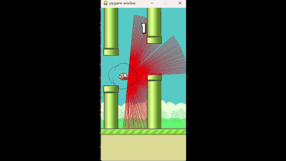

# Flappy Bird DQN Agent

A Deep Q-Network (DQN) agent written in PyTorch that learns to play Flappy Bird
through the Gymnasium `FlappyBird-v0` environment. The agent chooses between the
environment's available actions using learned Q-values and epsilon-greedy
exploration; there are no hand-coded rules for avoiding pipes.

## Features

- DQN policy network and target network
- Experience replay with randomly sampled mini-batches
- Epsilon-greedy exploration and decay
- Resume training from the latest saved network weights
- Save the best-reward model separately from the latest model
- Per-episode CSV history and a text log of new best rewards
- Hyperparameters loaded from `parameters.yaml`
- Optional rendered training, headless training, and rendered evaluation

## Requirements and installation

Verified with Python 3.13.9. Create a virtual environment and install
dependencies:

```powershell
python -m venv .venv
.\.venv\Scripts\Activate.ps1
python -m pip install -r requirements.txt
```

On macOS or Linux, use `python3 -m venv .venv`, then activate with
`source .venv/bin/activate` and install with `python -m pip install -r requirements.txt`.
Dependencies include PyTorch and Gymnasium.

## Run the agent

Run these commands from the project directory. Training opens the game window
by default and saves the latest model after each episode:

```bash
python agent.py flappybirdv0
```

Train without rendering or watch the best saved model:

```bash
python agent.py flappybirdv0 --episodes 5000 --no-render
python agent.py flappybirdv0 --play
```

Use `--minutes N` to set a training time limit, or `--episodes N` to set an
episode limit. Training can be stopped with `Ctrl+C`; the latest model is
saved, but the replay buffer and optimizer are not restored when resuming.

## Training history

Training records episode, reward, and exploration rate in
`runs/flappybirdv0_episodes.csv`. Evaluation with `--play` does not change this
file.

## Hyperparameters

Values below are read from `parameters.yaml`:

| Parameter | Value | Description |
|---|---:|---|
| Environment | `FlappyBird-v0` | Gymnasium environment ID. |
| Learning rate (`alpha`) | `0.001` | Adam optimizer learning rate. |
| Discount factor (`gamma`) | `0.99` | Weight given to future rewards. |
| Replay memory capacity | `100,000` | Maximum transitions retained for sampling. |
| Mini-batch size | `32` | Transitions sampled for each gradient update. |
| Target network sync interval | `10` steps | Copy policy weights to the target network every 10 environment steps. |
| Initial epsilon | `1.0` | Start by exploring with random actions. |
| Minimum epsilon | `0.05` | Minimum exploration probability. |
| Epsilon decay | `0.9995` | Multiplier applied to epsilon after each episode. |
| Reward threshold | `1,000` | Episode stopping threshold configured by the script. |
| Hidden layer width | `256` | Number of units in the DQN's hidden layer. |

## Results

Results from the current saved files (not a guarantee of future performance):

- Training history: **17,346 episodes** recorded in the CSV.
- Best reward recorded during training: **9.1**.
- Best saved model evaluation: **2.69 average reward over 20 episodes**, evaluated
  without rendering using seeds 2026 through 2045.
- The highest reward in that 20-episode evaluation was **6.4**.

Training rewards vary between episodes. Use the CSV to review the full training
history and run more episodes if you want to compare results.

## Demo



[Open or download the full video](assets/Video%20Project%201.mp4)
(about 26 MB).

For more information about the project and its learning process, see the
[Flappy Bird DQN learning document (PDF)](assets/Flappy_Bird_DQN_Project_Report.pdf).

## Author

Vishal Kumar - [GitHub](https://github.com/vishu56096-ctrl)
